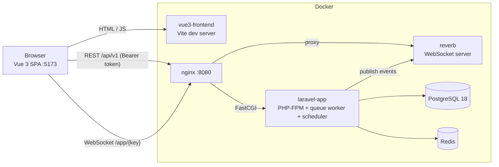

# Workspace: multi-theme clinic & shop platform

One **Laravel 13** API and one **Vue 3** single-page app that serve two branded products from the same codebase:

- **Clinic** (`doctor` theme): patients, appointments, check-in with staff presence, reports.
- **Shop** (`marketplace` theme): products, stock, orders, sales insights.

Both share authentication, role-based access control, team administration, a real-time chat (Laravel Reverb) and branded, bilingual (English / Greek) emails. Everything runs with one `docker compose up`.

---

## Contents

- [Highlights](#highlights)
- [Architecture](#architecture)
- [Getting started](#getting-started)
- [Configuration](#configuration)
- [Features](#features)
  - [Workspaces and sign-up](#workspaces-and-sign-up)
  - [Authentication](#authentication)
  - [Roles and permissions](#roles-and-permissions)
  - [Clinic](#clinic)
  - [Shop](#shop)
  - [Administration](#administration)
  - [Live chat](#live-chat)
  - [Branded emails](#branded-emails)
  - [Themes, languages and time zones](#themes-languages-and-time-zones)
- [API overview](#api-overview)
- [Project structure](#project-structure)
- [Development](#development)
- [Notes](#notes)

---

## Highlights

- **Two products, one codebase.** The tenant type (`doctor` / `marketplace`) picks the menu, the features, the colours, and the email templates.
- **One workspace per theme.** Everyone who signs up joins *Acme Clinic* or *Acme Market* as a chat-only **Member**; administrators promote them.
- **Fine-grained permissions.** 30 permissions in 10 groups, roles editable from the UI. The API enforces them, and the UI only hides what it can't use.
- **Real-time chat.** Rooms with audiences (everyone, admins only, specific roles), presence, typing indicators, unread badges, and mute and lock moderation.
- **Branded emails.** Verification and password-reset emails are designed per theme, sent as the organization, and written in the recipient's language.
- **Production-minded Docker stack.** Migrations run on every boot, there are health-checked service dependencies, and nginx proxies the websocket.
- **Tested.** 105 backend feature tests (Pest), strict TypeScript with vue-tsc, including checks for unknown components.

---

## Architecture



| Layer | Technology |
|---|---|
| API | Laravel 13, PHP 8.5, Laravel Passport (personal access tokens), Pest |
| Realtime | Laravel Reverb 1.x (Pusher protocol), Laravel Echo 2 + pusher-js |
| Frontend | Vue 3.5, TypeScript, Vite 8, Pinia, Vue Router, vue-i18n, PrimeVue 4 (Aura) |
| Data | PostgreSQL 18, Redis |
| Infra | Docker Compose, nginx, PHP-FPM, Node 22 |

### Docker services

| Service | Role | Host port |
|---|---|---|
| `vue3-frontend` | Vite dev server for the SPA | `5173` |
| `nginx` | Serves the API and proxies websockets (`/app/*`) to Reverb | `8080` |
| `laravel-app` | PHP-FPM. On boot it installs dependencies if needed, runs migrations, syncs permissions, seeds on first boot, and starts the queue worker and scheduler | – |
| `reverb` | WebSocket server, built from the same image as `laravel-app` | via nginx |
| `postgres` | Database | `5438` |
| `redis-alpine` | Redis | `6379` |
| `vue3-doctor`, `vue3-market` | Optional standalone single-theme frontends (`--profile standalone`) | `5174`, `5175` |

`laravel-app` only reports *healthy* once migrations have succeeded and PHP-FPM is listening, and nginx and Reverb wait for that.

---

## Getting started

**Requirements:** Docker with Compose v2.

1. Create the root `.env` (read by `docker-compose.yml`). See [Configuration](#configuration) for the variables.
2. Create `laravel-app/.env` from `laravel-app/.env.example`, and set `APP_KEY` and your SMTP settings.
3. Start everything:

   ```bash
   docker compose up -d --build --wait
   ```

4. Open **http://localhost:5173**.

On first boot the database is migrated and seeded with demo data. Every demo account's password is `password`:

| Workspace | Email | Roles |
|---|---|---|
| Acme Clinic | `admin@clinic.test` | Administrator + Doctor |
| Acme Clinic | `doctor@clinic.test` | Doctor |
| Acme Clinic | `reception@clinic.test` | Receptionist |
| Acme Market | `admin@market.test` | Administrator |
| Acme Market | `manager@market.test` | Store manager |
| Acme Market | `sales@market.test` | Sales associate |

To also run the standalone clinic and shop frontends:

```bash
docker compose --profile standalone up -d
```

---

## Configuration

### Root `.env` (Docker Compose)

| Variable | Purpose |
|---|---|
| `POSTGRES_DB_CONNECTION`, `POSTGRES_DB_HOST`, `POSTGRES_DB_PORT`, `POSTGRES_DB_HOST_PORT` | Database connection (`pgsql`, `postgres`, `5432`, host port) |
| `POSTGRES_DB_DATABASE`, `POSTGRES_DB_USERNAME`, `POSTGRES_DB_PASSWORD` | Database name and credentials |
| `REDIS_HOST`, `REDIS_PORT`, `REDIS_HOST_PORT` | Redis |
| `HTTP_HOST_PORT`, `HTTP_PORT` | nginx (API and websockets) |
| `VITE_API_URL`, `VITE_PORT` | Where the SPA reaches the API (e.g. `http://localhost:8080/api`) |
| `VITE_APP_THEMES`, `VITE_THEME_HOSTS` | Themes offered by the multi-theme SPA; theme per hostname |
| `TENANCY_THEMES` | Themes the backend serves (empty = all) |
| `AUTH_VERIFY_EMAIL` | Require email verification before using the app (`true`) |
| `FRONTEND_URL_DOCTOR`, `FRONTEND_URL_MARKETPLACE` | Only when the standalone frontends run: where emailed links point |
| `REVERB_APP_ID`, `REVERB_APP_KEY`, `REVERB_APP_SECRET` | Reverb credentials (the key is public; keep the secret private) |
| `REVERB_PUBLIC_HOST`, `REVERB_PUBLIC_PORT`, `REVERB_PUBLIC_SCHEME` | Where browsers open the websocket (nginx) |
| `REVERB_ALLOWED_ORIGINS` | Hosts allowed to connect (`*` in development) |

### `laravel-app/.env` (Laravel)

`APP_KEY`, `APP_ENV`, and `MAIL_*` (SMTP). Optional workspace settings:

| Variable | Default |
|---|---|
| `TENANCY_DOCTOR_WORKSPACE` / `_NAME` | `acme-clinic` / `Acme Clinic` |
| `TENANCY_MARKETPLACE_WORKSPACE` / `_NAME` | `acme-market` / `Acme Market` |
| `TENANCY_WORKSPACE_TIMEZONE` | `Europe/Athens` |
| `AUTH_TOKEN_TTL_MINUTES` | `720` |
| `AUTH_VERIFICATION_TTL_MINUTES` | `1440` |
| `PRESENCE_TIMEOUT_MINUTES` | `5` |

Docker passes the database, Redis, Reverb and theme settings into the container, and those override `laravel-app/.env`.

---

## Features

### Workspaces and sign-up

- **One workspace per theme.** Each theme has a single workspace, configured by slug: *Acme Clinic* (clinic) and *Acme Market* (shop). If a workspace is missing, it's created on demand together with its system roles.
- **Sign-up** asks for name, email, password and theme. The new user joins that theme's workspace as a **Member** (chat only), and the form says which workspace they're joining. An administrator then promotes them on the Team page.
- **Closed workspaces.** Sign-ups are refused while the workspace is deactivated.
- **Data isolation.** Every model is scoped to its workspace by a global tenant scope, applied before route model binding, so records of another workspace are a 404.

### Authentication

- **Tokens.** Bearer tokens from Laravel Passport personal access tokens (12-hour lifetime by default). The API never redirects.
- **Account endpoints:** login, sign-up, logout, current session (`/auth/me`), and profile (time zone, language).
- **Email verification.** The signed link opens the frontend of the account's theme. Until it's verified, the user can only reach their own session pages. Resending is rate-limited and reports mail outages clearly. The waiting page unlocks by itself once the link is opened in another tab, on another device, or when the tab regains focus.
- **Password reset.** The link is themed per account, and when the request comes from a standalone frontend it only acts on accounts of that theme.
- **Rate limits** on authentication, the API, verification emails and chat messages.

### Roles and permissions

All permissions are defined in `config/permissions.php` and synced to the database on every boot. Administrators implicitly hold every permission available to their theme.

| Group | Permissions |
|---|---|
| Common | `users.*`, `roles.*`, `chat.view`, `chat.mute`, `chat.manage` |
| Clinic | `patients.*`, `appointments.*` (including `appointments.check-in`), `presence.toggle`, `reports.view` |
| Shop | `products.*`, `orders.view/create/update`, `marketing.view` |

System roles created for every workspace:

| Clinic | Shop | Access |
|---|---|---|
| Administrator | Administrator | Everything, including team and roles |
| Doctor | Store manager | Day-to-day work, plus `chat.mute` |
| Receptionist | Sales associate | Front-line work, chat |
| Member | Member | Chat only (self-registered users) |

Administrators can create custom roles from a permission matrix. System roles can't be deleted or have their admin flag changed. The last active administrator can't be removed or demoted. Permissions are cached per user and invalidated per workspace the moment roles change.

### Clinic

- **Dashboard:** today's numbers (scheduled, waiting, checked in, staff online) and the live visitor queue.
- **Patients:** search, create, edit and soft-delete.
- **Appointments:** booking, rescheduling and a status workflow (scheduled → checked in → in progress → completed, or cancelled / no-show), with the allowed transitions computed by the API.
- **Check-in** requires the staff member to be **online**.
- **Presence:** an online/offline (on-duty) switch with a heartbeat; stale sessions are closed by the scheduler every 5 minutes, and a "who's online" team view.
- **Reports:** appointment totals by status and by reason over a chosen period.

### Shop

- **Dashboard:** products, active products, units in stock, low-stock items, today's orders, pending orders and revenue, plus recent orders and a low-stock list.
- **Products:** catalogue with SKU, category, price, currency, stock and active flag.
- **Orders:** placing an order checks stock and currency; the status workflow is pending → paid → shipped → delivered, or cancelled. Actions are colour-coded pill buttons, and cancelling asks for confirmation.
- **Insights:** best-selling products by units and revenue.

### Administration

Shared by both themes:

- **Team:** invite and edit members (new members get a verification email), assign roles and deactivate members.
- **Roles and permissions:** create and edit roles with a grouped permission matrix.

### Live chat

Real-time team chat, built on Laravel Reverb and Laravel Echo.

**Rooms**

| Room | Who can enter |
|---|---|
| **Global** (default) | Everyone in the workspace. It can't be deleted, and its audience can't be changed. |
| Announcements | Everyone reads; only administrators can post (locked room) |
| Admins | Administrators only |
| Doctors / Store managers | That role, plus administrators |
| Custom rooms | Everyone, admins only, or specific roles |

- **Room management.** Users with `chat.manage` create and edit rooms. Administrators can set any audience; other room managers can only open rooms to everyone or to roles they hold.
- **Access is enforced everywhere.** A room outside your audience is a 404 in the room list, the message history, the members list and by message ID. Its websocket channels refuse you too, so its messages never reach you.

**Messaging**

- Live delivery, typing indicators, and an online list per room through presence channels.
- Unread badges per room, and a total on the navigation link.
- History loads as you scroll up, messages are grouped by author and day, and there's a "new messages" jump button.
- Drafts are kept per room. Enter sends; Shift+Enter starts a new line.
- If the websocket drops, the page catches up after reconnecting and refreshes every 10 seconds in the meantime.

**Moderation**

- Administrators can mute **everyone**, other administrators included.
- Members holding `chat.mute` can mute **everyone except administrators**.
- Nobody can mute themselves.
- Mutes apply to one room or to all rooms, for 15 minutes, 1 hour, 24 hours, 7 days, or until lifted, with an optional reason. Muted members can still read.
- Administrators can **lock** a room, which mutes everyone except administrators.
- The same hierarchy decides who can delete someone else's message.

**Realtime channels**

| Channel | Carries |
|---|---|
| `private-chat.feed.{room}` | A room's messages (only its audience can join) |
| `presence-chat.room.{room}` | Who has the room open, and typing whispers |
| `private-chat.tenant.{id}` | Workspace signals (room changes, mutes) |

### Branded emails

- **Templates per theme.** Each theme has its own email verification and password reset templates (`resources/views/mail/{theme}/`), with a generic fallback for future themes.
- **Branding.** Each theme has its own colours and mark, set in `config/branding.php`. The organization's name is used as the sender name and in the content, and there's a plain-text version of every email.
- **Language.** Emails are written in the recipient's language: theirs, otherwise the workspace's (`lang/{en,el}/mail.php`).
- **Preview without sending** (local only): `http://localhost:8080/dev/mail/{verify-email|reset-password}/{doctor|marketplace}?lang=el&format=text`

### Themes, languages and time zones

- **Multi-theme app.** Guests choose a theme; signing in locks it to the account's workspace type.
- **Standalone apps.** Set `VITE_APP_THEME` or `VITE_THEME_HOSTS`. Each request then sends `X-App-Theme`, so sign-in and password reset only act on accounts of that theme.
- **Per-theme look.** Each theme has its own palette (clinic blue, shop red and amber) and a favicon recoloured to match.
- **Languages.** English and Greek throughout, in both the UI and the API messages.
- **Time zones.** Each user's own, otherwise the browser's or the workspace's. The API stores UTC and returns ISO-8601 dates in the viewer's time zone.

---

## API overview

The API is versioned under `/api/v1`. Responses are JSON, and errors carry a machine-readable `code` where it's useful (e.g. `chat_muted`, `email_unverified`).

| Prefix | Endpoints |
|---|---|
| `GET /app` | Public bootstrap: served themes, workspace names, languages, features |
| `/auth` | `login`, `register`, `forgot-password`, `reset-password`, `email/verify/{id}/{hash}`, `me`, `logout`, `profile`, `email/resend` |
| `/admin` | `users`, `roles` (REST), `permissions` |
| `/doctor` | `dashboard`, `patients`, `appointments` (+ `check-in`, `status`), `presence` (+ `online`, `heartbeat`, `offline`, `team`), `reports/summary` |
| `/marketplace` | `dashboard`, `products`, `orders` (+ `status`), `insights/top-products` |
| `/chat` | `rooms` (+ `read`, `messages`), `messages/{id}`, `members`, `mutes` |
| `POST /broadcasting/auth` | Websocket channel authorization (same token and workspace checks) |

---

## Project structure

```
.
├── docker-compose.yml
├── configuration/
│   ├── app_conf/          # PHP image (Dockerfile, entrypoint.sh: migrate on boot)
│   ├── fronted_conf/      # Node image for the SPA
│   ├── nginx/             # API + websocket proxy
│   └── postgres/          # init.sql
├── laravel-app/
│   ├── app/
│   │   ├── Authorization/       # roles, permission registry, cache, sync
│   │   ├── Tenancy/             # tenant scope/context, themes, workspaces
│   │   ├── Services/            # Auth, Admin, Doctor, Marketplace, Chat
│   │   ├── Mail/Branding/       # per-theme email brand + copy
│   │   ├── Notifications/Auth/  # branded verify / reset emails
│   │   ├── Events/Chat/         # broadcast events
│   │   └── Http/                # controllers, requests, resources, middleware
│   ├── config/            # permissions.php, tenancy.php, branding.php, reverb.php
│   ├── database/          # migrations, factories, seeders (demo data)
│   ├── lang/{en,el}/      # API + email wording
│   ├── resources/views/mail/
│   ├── routes/            # api.php, channels.php, web.php, console.php
│   └── tests/Feature/     # Pest test suite
└── vue3-frontend/src/
    ├── api/               # typed HTTP client + endpoints
    ├── stores/            # auth, user, access, preferences, theme, presence, chat
    ├── services/          # theme, realtime (Echo)
    ├── themes/doctor|marketplace/   # theme-specific pages
    ├── views/             # auth, admin, chat, settings, errors
    ├── components/        # shared + chat components
    ├── config/            # navigation, editions (multi / standalone)
    └── locales/           # en.json, el.json
```

---

## Development

```bash
# Backend tests (in-memory SQLite, never touches the real database)
docker compose exec -u www-data laravel-app php artisan test

# Frontend type-check and production build
docker compose exec vue3-frontend npx vue-tsc --noEmit
docker compose exec vue3-frontend npm run build

# Migrations (also run automatically on every container start)
docker compose exec -u www-data laravel-app php artisan migrate

# Re-sync permissions (also on every start); --roles resets system roles to config
docker compose exec -u www-data laravel-app php artisan permissions:sync

# Demo chat rooms and messages (idempotent)
docker compose exec -u www-data laravel-app php artisan db:seed --class=ChatDemoSeeder

# Logs (Laravel logs live in the laravel-app-data-logs volume)
docker compose exec laravel-app tail -f storage/logs/laravel.log
docker compose logs -f reverb
```

- **Scheduled tasks:** `presence:close-stale` every 5 minutes, and `passport:purge` daily. Both run inside `laravel-app`.
- **Queue:** a `database` queue worker runs inside `laravel-app`. Chat events are broadcast immediately and don't use the queue.
- **When to restart Reverb:** only after changing `config/reverb.php` or the `REVERB_*` values (`docker compose restart reverb`).

---

## Notes

- **Guzzle stays on 7.x.** Laravel Reverb 1.x requires `guzzlehttp/psr7 ^2`; move back to Guzzle 8 once a Reverb release supports psr7 3.
- **Before going to production:** set `APP_ENV=production`, use your own Reverb keys, restrict `REVERB_ALLOWED_ORIGINS`, put a password on Redis, serve everything over HTTPS (`REVERB_PUBLIC_SCHEME=https`), and review `composer audit`.
- **Never commit the `.env` files:** they hold the database password, the Reverb secret and SMTP credentials.
- Used opus 5.5.
